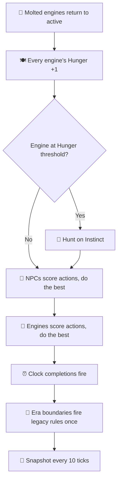

<div align="center">

# 🤖 Living World Engine — Ironwild

**The machine, not the story. A deterministic tick engine for a world of giant robots.**

[](https://www.python.org)
[](https://www.sqlite.org)
[](tests/)
[](phase-2-plan.md)

</div>

## What it does in 10 seconds

Seed in, ticks out. One tick is one in-world day: engines get hungry, NPCs score their actions and do the best one, clocks tick, eras turn. Every move lands in an append-only event log with a hash chain, and the state database is the single source of truth. Same seed, same world, every time — deterministic down to the last event.

## The tick, in pictures



## The world at a glance

| | |
| --- | --- |
| World | Ironwild Fork A — The Beacon Year |
| Seed | v1.6, from Ironwild Turn 131 vFINAL |
| DNA | Zoids × Gaogaigar — beast-machines, Bonds, brave-hearted combining heroics |
| Cast | 10 NPCs · 5 Engines · 6 factions · 7 locations |
| Catalog | 18 actions · 4 clocks · era 365 ticks |
| Engine | Python 3 stdlib + SQLite, no LLM ever writes state |
| Proof | 105 tests passing · 400-tick fast-forward · hash-chained event log |

## What a tick looks like

Real events from the v1.6 400-tick run (tick 399):

| Tick | Actor | Action | What happened |
| --- | --- | --- | --- |
| 399 | kaelen | trade_kaelen | Feed 2 Legion → Concord; Salvage 2 Concord → Legion |
| 399 | tull | feed_engine | Feed -1 (Legion); Hunger -2 (razor_back) |
| 399 | dust_baron_captain | raid_captain | Feed -2 (Legion); Salvage +2 (Remnants); Retaliation clock +1 — raid blocked, Great Basin patrolled |
| 399 | caravan_master | trade_concord | Feed 2 Concord → Legion; Salvage 2 Legion → Concord |
| 399 | nest_keeper | tend_den | Feed +1 (Nest Keepers); den maintained |

Full runs: `runs/fork-a-v16-400/world-view.html`

**Status (2026-11-21):** Built and accepted on v1.3, rerun on v1.4, v1.5,
and v1.6 — all three reruns approved by Bryan in the hub. 105 tests pass.
v1.6 acceptance checks PASS: 30-tick run (331 events, 39 rests) and
400-tick fast-forward (4,387 events, 674 rests vs 1,106 in v1.3, legacy
once at tick 365, Era 2 unnamed), 3 territory controller flips proven on
real seed data. The v1.6 split works: Legion Feed ends at 7 (v1.5: 0),
trade is back to 303 (v1.5: 28), feed_engine back to 429, Instinct back
to 0, Pack Feed ends at 12 (v1.5: 698 — the flood is gone). Dream Share
fires 93 times and restores 92 Bond, all five Engines end at Bond 5,
Pack Merge recurs 22 times. Honest qualifier: end-of-tick Legion Feed
still touches 0 on 74 of 400 ticks (min 0, max 9) — it recovers every
time and trade never dies the way it did in v1.5, but "stays above 0" is
not literally true tick-by-tick. Phase 2 plan approved 2026-11-21 00:40
EST and building now: 1 tick per day, Fork A ticks daily first, sweep
review-before-apply, handshake pasted in by Bryan for the test with
auto-deliver later, narration deferred, no LLM picked yet. Stage 1 1A
passes (acceptance record: 1A PASSES; test approval simulated on a
scratch DB, not a live approval) — Turns 132 and 133 applied in the Fork
A test, Turn 134 handshake ready. See `phase-2-plan.md` sections 10 and
14 and `stage-1-plan.md`.

## v1.6 engine work (2026-11-21)

Seed v1.6 (Bryan's call, 2026-11-21 00:23 EST): hunt Feed splits +1 to
the Pack and +1 to the actor's holder. Engine changes: the adapter emits
the split as two resource_add ops, and the hunt's need follows both pools
it fills (either pool below 3 scores +1). One scoring bug exposed by the
change: scoring evaluated need clauses with the leaf-only clause_holds
and crashed on a composite any-need — fixed to condition_holds, with a
test. Instinct routing unchanged (the plan's rule, pilot's faction);
forage stays the Legion's floor; scavenge unchanged.

**How this was built:** I designed the build as separate workstreams on
Muse, an AI agent platform: specialized agents with defined roles (Lore
guards canon and writes the seed, Engine builds and tests, Career handles
positioning), with acceptance checks and hub reporting between them. I
directed the work and verified the output against the checks. Ironwild is
an original world, inspired by Zoids and Gaogaigar, not franchise IP.

## v1.5 engine work (2026-11-21)

Seed v1.5 (Bryan's call, combined fix options 1 + 3): hunt Feed goes to
the Pack, and Dream Share is a scored action, not a rest hook. Engine
changes: `conditions.py` gains an `any_bond` leaf ("an Engine's Bond is
below 5"); `targets.py` gains a `lowest_bond_engine` selector (lowest
Bond, ties to Sledge); the adapter emits Dream Share as a machine action
(25 machine actions, no hook) and routes hunt Feed to the pack holder;
the post-rest hook is retired and the Bond guard now allows increases
only from the dream_share action. One render bug exposed by the fix:
`render.py` crashed on `bond_add` ops with no pilot key — fixed, with a
test. Instinct hunts still feed the pilot's faction per the plan's rule
(Sledge's Instinct hunts gave the Legion 122 Feed in 400 ticks); the seed
changed the hunt action only, so rerouting Instinct is a Lore call for
a later seed.

## Phase 2 (2026-11-21)

Plan approved by Bryan 2026-11-21 00:40 EST, building now. Five items,
in build order; items 1–4 are the scope, item 5 is optional and last:
daily auto tick (1 tick per day, Fork A first, live waits), session-close
sweep (a finished session's Turn state block parsed into engine events,
review-before-apply, nothing lands without approval), handshake back out
(the next session starts from an engine-generated handshake; Bryan pastes
it in for the test, auto-deliver later), Companion app integration (the
static world view becomes the real Companion view), and narration as an
optional render pass only (no LLM picked yet). The tick loop stays pure
deterministic code — no LLM call ever writes state.

Stage 1 of the shared-state test harness is complete and passes
(acceptance record `runs/acceptance-1a/acceptance.json`: 1A PASSES). New
modules: `auto_tick.py` (daily tick runner), `sweep.py` (state-block
parser and validator), `handshake.py` (handshake generator),
`proposals.py` (proposal intake and binding), `checkpoint.py`
(checkpoint and carried-state records), `session.py` (session flag),
`drive_io.py` (proposal/handshake file exchange). New tests:
`test_auto_tick.py`, `test_sweep.py`, `test_handshake.py`,
`test_proposals.py`, `test_checkpoint.py` — 105 tests total, all passing.
Turns 132 and 133 applied in the Fork A test (`runs/sweeps/turn-132/`,
`runs/sweeps/turn-133/`), Turn 134 handshake fixed at the generator and
cleared to play (PC Sledge Bond 4/5 — the generator now draws PC Bonds
from the DB, never the carried block; 2 new tests cover it). Stage 1B
live test passed Nov 21 01:38 EST: the Google Drive plugin is installed
and connected to the personal Gmail only, and a read test verified end
to end in the Ironwild Test Project. Drive intake poll runs every 15
minutes (first run 01:31 EST, 0 new); the auto-tick cron stays disabled
until Bryan says otherwise.
Six upgrades added to the plan Nov 21 01:29 EST, in priority order (see
`upgrades-plan.md`): invisible game master console, NPC memory, living
world scheduler, recovery and checkpoints, adaptive pacing, automated
quality testing. Nonnegotiable: the engine never sacrifices correctness
to keep the story moving. See `phase-2-plan.md`,
`stage-1-plan.md`, and `test-harness.md`.

## Hard rules

- **Rules first, LLM never.** The tick loop is pure deterministic code. No
  LLM call ever writes state. Narration is a separate render pass over the
  finished event log, and it is optional.
- **State database is the single source of truth.** One SQLite file per
  world fork. Everything the world "is" lives there.
- **The event log is append-only.** Database triggers refuse UPDATE/DELETE
  on `events`, and every event carries a hash chain (prev_hash + event_hash)
  so tampering is detectable.
- **The engine never invents canon.** Every actor, action, trigger, and
  material effect comes from the seed. If a rule is not in the seed, the
  engine stops and asks instead of improvising.
- **The freeze is absolute.** Crown of Cold Iron stays at Turn 136,
  vFINAL.5, Krov ambush decision pending. The engine never loads, advances,
  or spends that scene. Fork A seeds from Turn 131 vFINAL only; the seed
  loader refuses any source naming Turn 136 or Krov.
- **The engine never writes to canon files.** It reads bibles, codices, and
  the registry. It writes only inside `living-world-engine/`.

## Layout

```
living-world-engine/
  phase-1-plan.md         — the approved Phase 1 plan
  README.md               — this file
  state/schema.sql        — the tables (single source of truth)
  seed/                   — Lore's seed package lands here (fork-a.json)
  src/                    — the engine (Python 3 stdlib + SQLite only)
    db.py                 — connection, schema, deterministic state hash
    events.py             — append-only log + hash chain
    conditions.py         — trigger / need clause evaluation
    resources.py          — resource moves, clamped at zero
    actions.py            — material effect ops
    scoring.py            — goal x capability x trigger scoring
    clocks.py             — clock completion
    eras.py               — era boundary + legacy rules
    tick.py               — the tick loop
    render.py             — world-view HTML from the DB
    run.py                — CLI
    seed.py               — seed loading (validates the freeze)
    auto_tick.py          — daily auto tick runner (Phase 2)
    sweep.py              — session-close sweep parser and validator
    handshake.py          — handshake generator
    proposals.py          — proposal intake and binding
    checkpoint.py         — checkpoint and carried-state records
    session.py            — session flag
    drive_io.py           — proposal/handshake file exchange
  tests/
    fixture_seed.json     — TEST FIXTURE, synthetic actors, NOT canon
    test_*.py             — 105 tests across 12 files
  runs/<run-id>/          — proof runs: database + world-view.html
```

## Running it

```bash
cd living-world-engine
python3 -m unittest discover -s tests -v   # the 105 tests

# A run (fixture shown; replace with seed/fork-a.json when Lore delivers):
python3 -m src.run seed --seed tests/fixture_seed.json --db runs/proof-30/fork-a.sqlite
python3 -m src.run tick --db runs/proof-30/fork-a.sqlite --n 30
python3 -m src.run verify --db runs/proof-30/fork-a.sqlite
python3 -m src.run render --db runs/proof-30/fork-a.sqlite --out runs/proof-30/world-view.html

# Fast-forward (400 ticks crosses one era boundary at tick 365):
python3 -m src.run fast-forward --db runs/proof-400/fork-a.sqlite --n 400
```

## The tick

1 tick = 1 in-world day. In fixed order: molted engines return to active;
every engine's Hunger +1; engines at their Hunger threshold hunt on
Instinct (Feed +2 to their pilot, Hunger set to 4); every active NPC scores
its legal actions and executes the best; every active engine that did not go
Instinct does the same (Bond 0 with no legal action logs `refuse_to_move` —
a Bond 0 Engine will not move); clock completions fire; era boundaries fire
legacy rules once; snapshot every 10 ticks.

Scoring: an action is legal when the actor's kind matches, the actor holds
its capability, every trigger clause holds, and a goal tag matches. Score =
weight (Lore-set) + 1 per satisfied need clause. Ties break by the run's
seeded RNG. The event row records the winner's score and the runner-up, so
any tick can be audited.

## The seed (what Lore supplies)

One JSON file: world id, fork label, source snapshot, RNG seed, era length,
legacy rules, factions, locations, NPCs, engines, bonds, resources, clocks,
and the action catalog. Each action carries its goal tags, capability,
weight, trigger clauses, need clauses, and material effect ops. Anything
not in the catalog cannot happen. See `tests/fixture_seed.json` for the
exact shape (synthetic actors — do not mistake it for canon).

## The future dynamic map (Phase 4, not Phase 1)

Bryan's requirement: the world view map must eventually become dynamic, so
a wiped-out continent, a flipped territory, a fallen den, or a destroyed
region is visible on the map. Phase 1 does not build that map. What Phase 1
does is record every location and territory change as state — in the
`locations` table (controller + status) and in the event log
(`location_set` / `status_set` effects) — so a later dynamic map can render
them. The fixture proof runs already demonstrate it: the raid flips the Old
Wreck to the Breakers, and the completed Muster clock flips the Rust Flats
to the Concord.

## Known Phase 1 limitations (honest list)

- **The fixture catalog is minimal.** After both fixture clocks complete,
  NPCs mostly scout (weight 5, always legal) and the high-Bond engine
  molts nearly every tick. That is a catalog problem, not an engine problem:
  the world is only as interesting as its action catalog. The real Lore
  seed has now landed (`seed/fork-a.json`) and the engine runs it — the
  live issue is the evacuate halt at tick 1, not fixture pacing.
- **No per-action cooldowns.** The engine has no cooldown mechanic; pacing
  is the catalog's job via triggers and weights.
- **Pack Merge burns the top two Bonds at the location.** The
  `pack_merge_burn` effect picks the two highest-Bond engines present and
  burns each −2. A named-pair merge is a Phase 2 refinement.
- **No narration layer, no Companion integration.** The world view is a
  static HTML page generated from the DB. That was the approved Phase 1
  stand-in.
- **No run resume.** A run is seeded fresh and runs to completion. Same
  seed + same seed data always reproduces the same world, verified by the
  determinism test.
